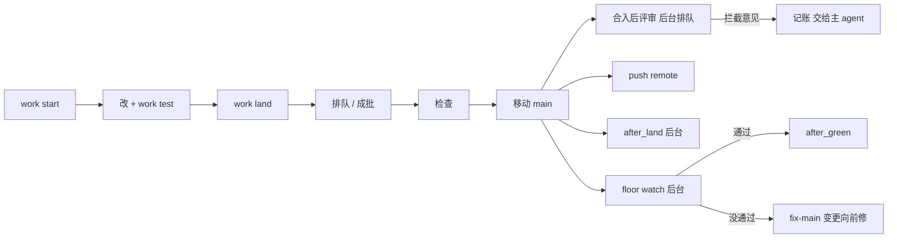

# 架构总览

只写现在的样子，只画两层：上下文（谁在用、依赖什么外部系统）和容器（运行时有哪些部件、数据存在哪、谁调用谁）。每一节末尾的编号指向为什么这么做的决策。这里只回答“哪个部件、数据在哪、谁调谁”：步骤的先后和每个行为的要求写在规则里，部件内部怎么分看领域 README（`canon context <路径或领域>`），领域清单看 `canon rule domains`。改了部件或谁调谁的变更，同一次合入里更新这里（D-65）。

分两类写：「canon 做的」是装了 canon 的任何项目都有的部件；「本项目配的」是 canon 自己这个仓库在 `canon/config.yaml` 里配的东西，别的项目不一定有。

## 上下文

- **使用者**：在项目里干活的 AI 会话（Claude Code、Codex），常常几个同时在跑；负责方向的人，只回答 `canon human` 里的问题。
- **git**：一切的底座。main 是一个分支，每个变更一个 worktree 和分支；canon 的协调数据放在 git 公共目录里。
- **Claude Code、Codex**：会话运行在宿主中。按明确目标将同一份 skill 分发到 `.claude/skills` 或 `.agents/skills`，合并宿主的 hook 和 Codex 原生指令入口。运行时边界归一化会话、子线程和工具事件，共用协调与问答佐证流程；`canon usage` 仍只读 Claude 的会话记录（D-101）。
- **项目配置的 reviewer**：新建项目按明确的安装目标选初始评审命令，已有配置不自动更换；用于合入后的规则评审和重复评审、合入时的措辞判断、canon finding reconcile 的合并评审（BR-2461），命令由 `canon/config.yaml` 的 `review` 配置；合入后的代码评审也是项目自己配的；canon 仓库发布前的发布评审用同一个 `review` 命令（BR-2411）。
- **GitHub**：`canon issues` 列出开着的 issue（`src/work/issues`，只读，关闭用 `gh`）；canon 仓库的发布评审拦截时新建或评论一个 `canon-review` issue（BR-2411）；决策里引用的网址在合入时被抓取核对；`remote` 指向它时合入后把 main 推上去。
- **项目自己的命令**：floor、类型检查、测试、选测试的命令（`test_select_command`）、挑选相关文档的命令（`related_pick_command`，可选，通常是一个便宜模型；只有 `canon context <编号>` 和 `canon work review` 运行它，编辑 hook、`canon check` 和合入不运行，BR-2443）、`setup`、生命周期 hook，由 `canon/config.yaml` 配置，canon 只运行它们、看退出码；测试命令把 JUnit XML 报告写到 `{report}`，canon 读报告里有哪些测试、跑没跑，不认语言（D-64）。

决策：D-1、D-2、D-9、D-45、D-51、D-64、D-101。

## 容器：canon 做的

**CLI 二进制 `canon`**
- 职责：全部命令；没有常驻进程（后台部件见下）；唯一一直运行的命令是前台的 `canon events --follow`，它是被调用方停止的长命令，不是后台部件（BR-2357）；跟随后台合入的 `canon work land` 也可能运行很久，它跟随的后台合入进程只活到这次合入结束（BR-2390）；`canon work test` 同样只跟随一个后台测试进程，它在自己的进程组里跑到测试结束，跟随的命令被终止时测试继续，再运行就接上，`--stop` 停下，事件记 `test.spawn`（BR-2467）。多数命令读运行它的 checkout 里的 `canon/config.yaml`；评审的命令、时限、提示预算 `review_max_prompt_kb`、同时运行的调用数 `review_parallel` 和常驻说明清单例外，取自合入前 main 上已合入的配置（BR-2074；用 `--again` 重新排的评审取重排时 main 的配置，BR-2449、D-117；挑选命令 `related_pick_command` 和它的时限也取自 main，BR-2443；`canon check` 的评审大小提示在 worktree 里也读 main 上的预算，D-76），所以在一次合入里改它们只对之后的合入生效；canon 仓库的发布评审（`scripts/release.ts`）读被发布提交自己的配置。
- 数据：无。
- 代码：`src/invocation`（命令声明、退出码、配置读取；`tree.ts` 汇总各领域的 `commands.ts`）、`src/invocation/reference`（配置项参考和 schema）；共享的 git、进程、结果类型在 `src/kernel`，不属于任何领域。
- 决策：D-2、D-3、D-4、D-15、D-28、D-63。

**协调数据库 `state.db`**
- 职责：多个会话同时工作时的共享状态：认领、合入队列、负责人标的优先合入（`canon backlog urgent`）、交接记录、留给人的问题、编号、端口、事件表（每次写入和拒绝）、后台部件的登记、排队的合入后评审（`landed_reviews`）、未处理的评审意见（`review_findings`，含 reconcile 互记的 `question` 列，见合入后的命令和评审）、挑选命令回答的缓存（`related_picks`，BR-2444）。
- 数据：`<git 公共目录>/canon/state.db`（SQLite），本机所有 worktree 共用，不提交、不跨机器。知识（规则、决策）不放这里。
- 代码：`src/work`（`db.ts`、`workspace.ts`），各子领域读写自己的表；`src/work/humans`（留给人的问题）、`src/work/stats`（从事件表算统计，`canon stats`、`canon events`、`canon usage`）。
- 决策：D-6、D-11、D-18、D-33、D-41、D-45、D-47、D-73。

**主 checkout 与工作 worktree**
- 职责：主 checkout 签出 main，main 只通过共享合入流水线前移；业务变更有 worktree `<仓库名>.worktrees/C-n`、分支 `change/C-n`、Change 文档和认领；杂务由 `canon chore start` 开工，工作树以 `chore-<UUID>` 命名，分支为 `chore/<UUID>-<slug>`，没有 Change 文档或 C 编号。分支是杂务身份和类型的恢复源，事件保存标题，认领只负责所有权；双方共用租约、交接、队列、端口和快照（D-100）。认领的持有者是会话，子 agent 的名字写在后面（`agent:<会话>:<名字>`）：子 agent 的认领类命令（`work start`、`land`、`stop`、`drop`，以及 `chore start`、`chore land`）带 `--as <自己的 agent_id>`，别的会话启动的 worker 会话带自己定的名字（BR-2468），主会话不带；主会话用 `canon work take <工作身份> --from <agent_id>` 接手子 agent 的工作，`take` 和 `unstall` 不给子 agent（BR-2340）；`take` 只在 Claude Code 或 Codex 的主会话里运行（BR-2336），`unstall` 主会话和人都能运行（BR-2455）。快照（每次 Bash 前给 hook 的 `cwd` 所在 worktree 和调用者自己认领的其他 worktree 各做一个，D-71）和归档是 git ref：`refs/canon/snapshots/*`、`refs/canon/archive/*`。
- 数据：worktree 里的代码和 `canon/changes/C-n.md`；每个 worktree 的 `.canon/`（生成的 schema，被 git 忽略）。
- 代码：`src/work/session`（开始、停下、交接、`canon brief`）、`src/work/claims`（认领、`--as` 的解析、`check-as` hook 的检查）、`src/work/drop`、`src/work/snapshots`。
- 决策：D-11、D-13、D-18、D-30、D-62、D-71、D-100。

**合入流水线（`canon work land`、`canon chore land`）**

两个入口使用同一队列、检查、main 比较并交换和后台结果。后台仍统一执行 work land，从各自分支解析工作身份，不继承批次领头者的类型。只有业务变更写关闭文档提交和 passes；杂务成功后只完成认领及交接，修改文档仍进入合入后评审。卸载删除配置后的重试从 main 配置恢复检查，配置删除形成批次边界（D-100）。
- 职责：把一个变更变成 main：排队（子 agent 的工作（变更或杂务）连续被拒三次就不再排队，交给主 agent，主会话用 `canon work unstall` 放行，BR-2454、BR-2455、D-99；上次因 `canon check` 被拒、内容和 main 都没变时，入队前先重跑 `canon check`，还有发现就不排队，BR-2388；`canon work test` 在这个分支上留下没重跑通过的失败时也不排队，BR-2463）、rebase 之后先把变更新加的引用的复核记录改进关闭提交（D-95），变更新增的决策也在关闭提交里转成 accepted（BR-2355、D-109），再在 rebase 后的树上跑确定的检查（`floor_timing: after` 时先向 PATH 上已发布的 canon 要它的配置 schema，拿被合入的配置去比，BR-2224；只改了措辞的通过记录要一次措辞判断，BR-2239，这是合入里唯一的模型调用）、移动 main（之后关闭点名了已作废文档的未处理评审意见，BR-2435）、合入后排队合入后的评审（BR-2441）、推送和启动后台命令；规则评审和重复评审不在合入里（D-89）；配了 `land_batch_max` 时把排队的变更串成一批在临时 worktree 里测；配了 `floor_scopes` 时只改某个范围的合入跑那个范围的命令、排到全量合入前面（D-82）。`canon work land` 只是跟随者：合入运行在它启动的后台合入进程里（自己的进程组，输出和退出码写在 `logs/land-run-*/`，`src/work/land/detach.ts`），调用者被杀或按 Ctrl-C 只脱离，再运行就接上（还在启动、正在跑，或已结束而没人看到结果的都算；判断和记下 `land.spawn` 在一个写事务里，同一 worktree 只开一次合入，BR-2392），`--stop` 停止；状态放 `state.db`。合入前的验证 `canon work test` 也在这里：选出和这个变更有关的测试文件（改动的、`test_select_command` 选出的、点名了碰过的规则的），一个文件一次运行，把 `test_command` 里的 `{report}` 换成临时路径，读 JUnit 报告并按（测试文件路径，内容哈希）记账，最后跑类型检查和 `canon check`。步骤的先后见 `canon/rules/work/land/README.md` 和各子领域规则。
- 数据：`state.db` 里的队列条目和测试报告记账；批在 git 公共目录下的临时 worktree。
- 代码：`src/work/land`（横跨整个流程）、`src/work/land/queue`、`src/work/land/batch`、`src/work/land/checks`、`src/work/land/finish`、`src/work/verify`、`src/work/remote`（合入后推 main，`canon sync` 只快进）。
- 决策：D-5、D-16、D-22、D-26、D-29、D-32、D-34、D-38、D-42、D-58、D-64、D-73、D-75、D-80、D-82、D-95、D-99、D-100、D-109。

**`canon/` 文档树**
- 职责：项目的共享记忆，进版本库：`canon/product.md`、`canon/architecture.md`、`canon/config.yaml`、`canon/backlog.md`、`canon/rules/<领域>/`（规则和领域 README）、`canon/decisions/`、`canon/changes/`、`canon/notes/`，需要时有 `canon/releases/`。一个文档一个文件，只在合入时改。
- 数据：Markdown 加 front matter。`canon check` 查格式、引用、路径、规则有没有被一个会运行的测试点名（读 `state.db` 里的测试报告记账，不运行测试，D-64）；在变更里还查决策 `决定` 新写的行点名的规则有没有链回决策，并提示推迟的话和没点名规则的条目（BR-2469、BR-2470、BR-2471，D-112）；`canon search`、`canon context` 读它，每次运行时现算，不存索引：`canon search` 逐字匹配加汉字二元组匹配，`canon context`、`canon work review` 和编辑 hook 给出规则或决策的相关文档（正文引用的双向关系图、二元组 BM25 全文、共用名字三种排名的倒数排名融合，D-90）；main 上配了 `related_pick_command` 时，`canon context` 和 `canon work review` 再让它从融合前 50 名里挑选，挑中的排在前面，回答按命令和提示的哈希缓存在 `state.db` 的 `related_picks` 表，失败时输出一行原因（`src/knowledge/query/pick.ts`，BR-2443 到 BR-2445）。规则和决策之间的引用只从正文读；复核过的引用记在引用方 front matter 的 `links` 里（`canon links confirm` 写，`canon check` 查它和正文对得上），有记录的只看记录；没记的由 `canon links`、`canon context`、`canon brief` 每次和 `canon/config.yaml` 的 `links_since` 起点提交那棵树比较，不另存；合入带 `--finish` 时在 rebase 之后把变更新加的引用的记录改进关闭提交（D-95）。
- 代码：`src/knowledge`（横跨整个领域）、`src/knowledge/documents`、`src/knowledge/check`、`src/knowledge/check/restatement`（复述别的规则的文字判定，hook、`canon check` 和规则评审共用，D-84）、`src/knowledge/domains`（领域的业务清单：README 的 `## 业务` 段、规则的 `business`、`canon check` 的核对，以及 `canon rule domains`、`canon context` 和 `canon rule new` 按业务分组的列表，D-96；新增领域要有决策点名它的检查，D-98）、`src/knowledge/query`（搜索、上下文和相关文档的融合排序）、`src/knowledge/releases`、`src/knowledge/plans`（变更文件里 `## 计划` 表的读取、检查和 `canon plan status`，步骤状态由做它的变更算出）、`src/knowledge/links`（引用和可疑引用、`canon links`）、`src/work/execution`（规则的执行状态由变更里的通过记录算出）。
- 决策：D-1、D-12、D-14、D-15、D-32、D-61、D-64、D-65、D-77、D-84、D-90、D-95、D-96、D-98、D-112。

**装进项目的 hook、skill 和 git 守卫**

- 职责：Claude Code 和 Codex 的原生 hook（会话开始跑 `canon brief`；每次 Bash 前快照、检查 `canon work` 和 `canon chore` 的认领命令带不带 `--as`，子 agent 的 `take` 和 `unstall` 一律拒绝（`canon work check-as`，只拒绝、不改写，BR-2340；没有 `agent_id`、会话进程上面还有 `claude` 进程、或环境里有 `CLAUDE_DELEGATE_CHILD=1` 的 Claude Code worker 会话按子 agent 要求自己的 `--as`，BR-2468、D-111、D-114）；提问工具之后记录回答；Claude 的 Write、Edit、MultiEdit 或 Codex 的 apply_patch 之后提示改动的规则或决策在新行里复述了别的规则，并列出和它最相关的几份文档，`canon restatements --hook`，不调模型，D-84、D-90）、两端的 canon 技能入口、git 的 `reference-transaction` hook（main 只能由共享合入流水线移动，`canon work land` 和 `canon chore land` 跟随的是同一个后台合入；新建文档的命令也问 `githook.ts` 当前签出是不是受守卫的 main，是就拒绝，BR-2409）。
- 数据：Claude 的 `.claude/settings.json`、`.claude/skills/`；Codex 的 `.codex/hooks.json`、`.agents/skills/` 及有效根 AGENTS 文件的管理段；git hook 目录里的守卫文件。canon 自己仓库的 .agents/skills 是随源码提交的源头链接，不由安装器创建；Codex 的线程亲缘存在共享事件表（D-101）。skill 的来源是 canon 自己仓库的 `.claude/skills`；编译好的 `dist/canon` 先用和它一起发布的 `dist/skills`，npm 包用包里的，`CANON_SKILLS_SOURCE` 可以另指（BR-2082、BR-2412）。`canon init` 和 `canon update` 还写只有标题的 `canon/architecture.md`（已有的不覆盖），以及 `canon/config.yaml` 里缺少的 `links_since`（main 当时的提交，已有的不改，BR-2032、BR-2452）。
- 代码：`src/install`（`init`、`install`、`update`、`uninstall`、`githook.ts`）。
- 决策：D-9、D-10、D-16、D-36、D-46、D-53、D-62、D-65、D-84、D-101。

**后台 floor watch（`floor_timing: after` 时）**
- 职责：合入后在 git 公共目录下的临时 worktree 里，对 main 的最新提交按批跑 floor；通过就移动 `refs/canon/green` 并运行 `after_green`；没通过就记下，由下一个会话 `canon work start --fix-main` 向前修。
- 数据：`refs/canon/green`，`state.db` 里的 watcher 和 red_main 表，日志在 git 公共目录下。
- 代码：`src/work/watch`。
- 决策：D-31、D-55、D-59。

**合入后的命令和评审**
- 职责：合入后在主 checkout 里后台运行配置的 `after_land` 命令，记下日志和退出码；运行和记录配置的生命周期 hook、每个变更的端口 `CANON_PORT`；合入后的规则评审和重复评审：合入把要评审的合入排进 `landed_reviews`，并在没有活着的评审进程时启动后台的 `canon work review-landed`，它一次运行一个、按排队顺序，在合入前 main 的提交上的临时 worktree 里调用 `review` 命令（`--again` 重新排的在重排时 main 的提交上，评审命令修好后才能重跑成，BR-2449、D-117）（拆成几次调用时同时运行，D-83；同样的提示通过过就沿用，同一变更的改动文档和上次通过时一样就只对之后合入 main 的文档做小评审，D-70、D-81），拦截意见全部记进 `review_findings`，日志逐条列出、交给主 agent 用 `canon finding close` 当场处理（BR-2441、BR-2442、D-89、D-99）；方向相反的两条意见由主会话用 `canon finding reconcile` 交给评审求两边都满足的写法，给不出时记成留给人的问题并和意见互记（BR-2461、D-103）；负责人随时用 `canon accept` 验收 main 的当前提交（`src/knowledge/accept`）：条件、退出码和当场跑 floor 的时机按 BR-2462，全部成立才把 `refs/canon/accepted` 比较并交换地前移，发版发布它指向的提交（D-89、D-104）；只挪了路径或只改了 `links` 复核记录的文件不评审，验收的评审完整性也按同一个范围算（BR-2009、D-106）；改动文档放不进一次调用时按文档分成几部分评审（BR-2448）；失败或没排上的评审用 `canon work review-landed --again <C-n>` 重新排（BR-2449）；`canon work after-land` 报告同一次合入的后台命令和评审。合入后的代码评审怎么跑由项目配。重复评审不评审 canon 装进项目、项目没改过的 skill 文件，只有这些文件改动的 `canon update` 合入不做重复评审；AGENTS 管理段改动仍按 BR-2143 评审（BR-2410）。规则评审的 `restatement` 标准针对新写的行，只拦和被抄规则说法不一致的复述，一致的只作建议，同一组文档只记一条；提示里附上这次新增或改动的行和文字判定找到的候选；小评审只附新增或改动的行（BR-2405、BR-2433、D-84、D-110）。规则评审还拦截这次往某个领域的业务清单里新加、却和这个领域已有业务说的是同一件事的业务（BR-2447、D-98）。
- 数据：`refs/canon/code-reviewed`，后台命令的日志和退出码（事件表）；排队的合入后评审在 `state.db` 的 `landed_reviews` 表里，运行它们的唯一进程登记在 `landed_reviewer`，每次评审的日志在协调数据库目录的 `logs/` 下；未处理的评审意见在 `review_findings` 表里，一个身份同时最多一行，挂在点名的每份文档上，关闭时记下方式和关闭它的事件（合入、判定或 `finding.close`；更早的有复问）；不拦截的建议不在这张表里，从合入后评审的事件读（更早的从 `land.ok` 读，D-21、D-97）。
- 代码：`src/work/hooks`（`after-land.ts` 汇总后台命令和评审）、`src/knowledge/review`（`landed-queue.ts` 是评审的队列和后台进程，`landed.ts` 跑一次合入后评审）；未处理的评审意见在 `src/knowledge/review/findings`，`canon context`、`canon brief` 显示它们，合入、`canon finding close`（BR-2453）和 `canon verdict record` 关闭它们。
- 决策：D-2、D-19、D-21、D-51、D-59、D-84、D-89、D-97、D-98、D-99、D-103、D-104、D-106。

## 容器：本项目配的

canon 这个仓库在 `canon/config.yaml` 里配了下面这些，是项目配置，不是 canon 的部件：

- **`dist/canon` 和 `dist/skills`**：只在主 checkout 里，PATH 上的 canon 指向 `dist/canon`，它装进项目的 skill 来自 `dist/skills`（指向 `skills-<提交>` 的符号链接）。`after_green` 运行 `scripts/release.ts`：先把测过的提交里所有 `canon-*` 的 SKILL.md 和工作说明放在一起做一次重复评审（同样的文字只评审一次；以上一次发布为基线，只拦碰到改动行的重复，发布成功时记 `release.published` 作为下一次的基线，D-107），通过才从这个提交编译二进制、复制 skill、切换链接；编译可以和别的发布并行，检查当前版本、放置、切换和清理在 `<git 公共目录>/canon/publish.lock` 的互斥段里做，段内重读当前版本（BR-2412）；拦截时什么也不发布，提一个 `canon-review` issue，退出码 1。不从没测过的 main 构建（D-31、D-91、D-107、BR-2411、BR-2412）。
- **`scripts/review-claude.sh`**：`review` 配的命令，用 `claude -p` 做规则评审，也用于发布评审（`CANON_REVIEW_KIND=release`）。
- **`scripts/code-review.ts`**：`after_land` 配的命令，攒批后让 `claude -p` 评审合入的代码，只找安全和并发问题，发现的提成 GitHub issue；没到点时在后台留一个等待进程（`--wait`，协调数据库的 `code_review_waiter` 保证只有一个），到点评审后退出（D-59、D-68）。
- **floor**：类型检查加 `scripts/test.sh`；`floor_timing: after`、`land_batch_max: 4`。

## 主要流程

- **一个变更**：`work start`（子 agent 带 `--as <agent_id>`，worker 会话带自己的名字，BR-2468）建 worktree、分支和认领，有未处理的评审意见时不开新变更（杂务、`--fix-main`、已开始的变更和用 `--settles` 点名要处理的意见的变更照常，BR-2464）；改完 `work test`（在后台进程里跑、命令只跟随，BR-2467；记下每个文件的 CPU 时间，指出大部分时间在空等的文件，BR-2472、D-113；总时限 `test_timeout_minutes`，默认 30 分钟，超过就停下并以 1 退出，写明最慢的文件和机器负载，BR-2466）；`work land --finish` 进合入流水线，只有 main 通过比较并交换前移；`work after-land <C-n> --wait` 等后台命令和合入后的评审；`work clean` 删 worktree。每一步的要求看 `work/session`、`work/verify`、`work/land` 的规则（D-5、D-16、D-22、D-62）。
- **后台 floor watch**：合入移动 main 后启动，在自己的进程组里；测过的结果决定 `refs/canon/green`，没通过的记进 red_main，`canon brief` 提示（D-31、D-55、D-59）。
- **问人**：`canon human ask` 把问题记进 `state.db`（`src/work/humans`）；人在对话里回答，提问工具的 hook 记录；`canon human answer --relayed` 对照记录，对不上只标记（D-6、D-45、D-47）；例外是带选项的问题，回答和原话说的选项不同、或把人自己的话改写了，按 BR-2021 拒绝。
- **计划**：大工作在变更文件的 `## 计划` 表里写步骤和依赖；做步骤的变更在 front matter 写 `plan: C-n` 和 `steps`（`canon work start --plan --step` 开工时写好，已经开工的用 `canon plan link` 补上）；`canon plan status` 从变更的状态算出每步已完成、进行中、可开始还是被挡住，不另存；`canon brief`（没认领变更的地方）列出有可开始步骤的计划，`canon change list` 标出步骤和计划进度，`canon work start --step` 提示这一步已有哪个变更在做，都用同一个算法（`src/knowledge/plans`，D-77）。
- **发版**：规则带 `release: R-n` 标签，计划变更也可以带（它的计划属于这个版本）；`canon release status` 按规则的执行状态和计划的进度算版本进度；`canon release ship R-n` 发布 `refs/canon/accepted` 指向的已验收提交：在那个提交上查规则全部通过、计划全部完成，加上负责人确认，然后开杂务把版本设为 shipped、`shipped_at` 写它；没有验收过的提交时拒绝，合入时查 shipped_at 已验收而不重算条件（`src/knowledge/releases`，D-61、D-79、D-100、D-105）。`canon update`、`canon uninstall` 同样使用杂务，保留各自原有预检查和文件保护。
