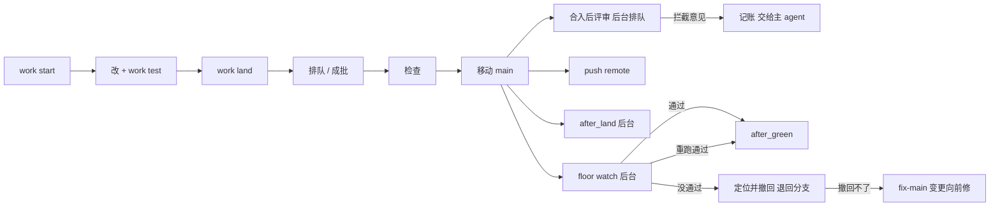

# 架构总览

只写现在的样子，只画两层：上下文（谁在用、依赖什么外部系统）和容器（运行时有哪些部件、数据存在哪、谁调用谁）。每一节末尾的编号指向为什么这么做的决策。这里只回答“哪个部件、数据在哪、谁调谁”：步骤的先后和每个行为的要求写在规则里，部件内部怎么分看领域 README（`canon context <路径或领域>`），领域清单看 `canon rule domains`。改了部件或谁调谁的变更，同一次合入里更新这里（D-65）。

分两类写：「canon 做的」是装了 canon 的任何项目都有的部件；「本项目配的」是 canon 自己这个仓库在 `canon/config.yaml` 里配的东西，别的项目不一定有。

## 上下文

- **使用者**：在项目里干活的 AI 会话（Claude Code、Codex），常常几个同时在跑；负责方向的人，只回答 `canon human` 里的问题。
- **git**：一切的底座。main 是一个分支，每个变更一个 worktree 和分支；canon 的协调数据放在 git 公共目录里。
- **Claude Code、Codex**：会话运行在宿主中。按明确目标将同一份 skill 分发到 `.claude/skills` 或 `.agents/skills`，合并宿主的 hook 和 Codex 原生指令入口。运行时边界归一化会话、子线程和工具事件，共用协调与问答佐证流程；`canon usage` 仍只读 Claude 的会话记录（D-101）。
- **项目配置的 reviewer**：新建项目按明确的安装目标选初始评审命令，已有配置不自动更换；用于合入后的规则评审、重复评审和措辞判断（BR-2239）、canon finding reconcile 的合并评审（BR-2461），命令由 `canon/config.yaml` 的 `review` 配置；合入后的代码评审也是项目自己配的；canon 仓库发布前的发布评审用同一个 `review` 命令（BR-2411）。
- **GitHub**：`canon issues` 列出开着的 issue（`src/work/issues`，只读，关闭用 `gh`）；决策里引用的网址在合入时被抓取核对，打不开、拒绝访问或不是网页的只提示并记 `source.unverified` 事件，照常合入（BR-2111、D-166）；`remote` 指向它时合入后把 main 推上去。
- **项目自己的命令**：floor、类型检查、测试、选测试的命令（`test_select_command`）、挑选相关文档的命令（`related_pick_command`，可选，通常是一个便宜模型；只有 `canon context <编号>` 和 `canon work review` 运行它，编辑 hook、`canon check` 和合入不运行，BR-2443）、`setup`、生命周期 hook，由 `canon/config.yaml` 配置，canon 只运行它们、看退出码；测试命令把 JUnit XML 报告写到 `{report}`，canon 读报告里有哪些测试、跑没跑，不认语言（D-64）。

决策：D-1、D-2、D-9、D-45、D-51、D-64、D-101。

## 容器：canon 做的

**CLI 二进制 `canon`**
- 职责：全部命令；没有常驻进程（后台部件见下）；唯一一直运行的命令是前台的 `canon events --follow`，它是被调用方停止的长命令，不是后台部件（BR-2357）；跟随后台合入的 `canon work land` 也可能运行很久，它跟随的后台合入进程只活到这次合入结束（BR-2390）；`canon work test` 同样只跟随一个后台测试进程，它在自己的进程组里跑到测试结束，跟随的命令被终止时测试继续，再运行就接上，`--stop` 停下，事件记 `test.spawn`（BR-2467）。多数命令读运行它的 checkout 里的 `canon/config.yaml`；合入时及合入后评审的命令、时限、单份提示预算 `review_max_prompt_kb`、同时运行的调用数 `review_parallel` 和常驻说明清单例外，取自合入前 main 上已合入的配置（BR-2074；用 `--again` 重新排的评审取重排时 main 的配置，BR-2449、D-117；挑选命令 `related_pick_command` 和它的时限也取自 main，BR-2443；`canon check` 的评审大小提示在 worktree 里也读 main 上的预算，D-76），所以在一次合入里改它们只对之后的合入生效；预览的设置按 BR-2358 取预览时的 main；总调用数和总提示预算的闸门仅适用于预览及合入后评审，配置来源和批准边界见 BR-2490。canon 仓库的发布评审（`scripts/release.ts`）读被发布提交自己的配置。
- 数据：无。
- 代码：`src/invocation`（命令声明、退出码、配置读取；`tree.ts` 汇总各领域的 `commands.ts`）、`src/invocation/reference`（配置项参考和 schema，以及 `canon config --flow` 按流程的配置视图和只读流程图，D-140）；流程的阶段和步骤在 `src/invocation/flow.ts`，每个配置项在自己的声明里写它配置哪几步；共享的 git、进程、结果类型在 `src/kernel`，不属于任何领域。
- 决策：D-2、D-3、D-4、D-15、D-28、D-63。

**协调数据库 `state.db`**
- 职责：多个会话同时工作时的共享状态：认领、派发快照（`delegations`，固定设计负责人、版本、契约和接受者，`take` 之后记下派发结束的时间；历史在事件表中）、设计请求（`design_requests`，属于变更，跟着设计负责人走）、合入队列、负责人标的优先合入（`canon backlog urgent`）、变更的档位（`priorities`，`canon priority set` 写）、交接记录、留给人的问题、编号、端口、事件表（每次写入和拒绝，每条记下写它的 canon 构建提交，源码运行记 `dev`，BR-2475）、后台部件的登记、排队的合入后评审（`landed_reviews`）、未处理的评审意见（`review_findings`，含 reconcile 互记的 `question` 列，见合入后的命令和评审）、挑选命令回答的缓存（`related_picks`，BR-2444）。
- 数据：`<git 公共目录>/canon/state.db`（SQLite），本机所有 worktree 共用，不提交、不跨机器。知识（规则、决策）不放这里。
- 代码：`src/work`（`db.ts`、`workspace.ts`），各子领域读写自己的表；`src/work/humans`（留给人的问题）、`src/work/stats`（从事件表算统计，`canon stats`、`canon events`、`canon usage`）。
- 决策：D-6、D-11、D-18、D-33、D-41、D-45、D-47、D-73、D-116。

**主 checkout 与工作 worktree**
- 职责：主 checkout 签出 main，main 只通过共享合入流水线前移；业务变更有 worktree `<仓库名>.worktrees/C-n`、分支 `change/C-n`、Change 文档和认领；杂务是只要标题的轻变更（D-148），由 `canon chore start` 开工，工作树以 `chore-<UUID>` 命名，分支为 `chore/<UUID>-<slug>`；开工时没有变更文件、不占 C 编号，合入时才在关闭提交里写出变更文件、分配 C 编号（D-150）。分支是杂务身份和类型的恢复源，事件保存标题，认领只负责所有权；双方共用租约、交接、队列、端口和快照（D-100）。认领的持有者是会话，子 agent 的名字写在后面（`agent:<会话>:<名字>`）：子 agent 的认领类命令（`work start`、`land`、`stop`、`drop`，以及 `chore start`、`chore land`）带 `--as <自己的 agent_id>`，别的会话启动的 worker 会话由派发方设 `CANON_SUBAGENT` 给出名字（BR-2495），没设时自己带 `--as`（BR-2468），主会话不带；主会话用 `canon work take <工作身份> --from <agent_id>` 接手子 agent 的工作，`take` 和 `unstall` 不给子 agent（BR-2340）；派发出去的变更由设计负责人 `take`，不论 worker 在哪个进程（BR-2500）；设计负责人的会话结束了（新会话、换机器），主会话或人先用 `canon work adopt` 接管它的派发（BR-2646），没有派发记录的子 agent 认领才按 BR-2336 只在 Claude Code 或 Codex 的主会话里 `take`，`unstall` 主会话和人都能运行（BR-2455）。快照（每次 Bash 前给 hook 的 `cwd` 所在 worktree 和调用者自己认领的其他 worktree 各做一个，D-71）和归档是 git ref：`refs/canon/snapshots/*`、`refs/canon/archive/*`。
- 数据：worktree 里的代码和 `canon/changes/C-n.md`；每个 worktree 的 `.canon/`（生成的 schema 和 `canon config --flow` 写的 `flow.html`，被 git 忽略）。
- 代码：`src/work/session`（开始、停下、交接、`canon brief`；没认领变更时 brief 列出 proposed 超过 24 小时的决策，BR-2476）、`src/work/claims`（认领、`--as` 的解析、`check-as` hook 的检查）、`src/work/delegation`（派发给 worker、接受设计版本、设计请求 `need-design` / `design-answer`、设计负责人用 `take` 收回派发，BR-2497 到 BR-2500、D-128；设计负责人的会话结束后用 `adopt` 接管它的派发（`adopt.ts`，BR-2646、D-165）；设计请求在协调数据库的 `design_requests` 表；新增 worker 时按内存压力、5 分钟负载和派发名额拒绝，内存压力从系统信号读（`src/kernel/machine.ts`），BR-2526、D-136；派发写 `--light "<理由>"` 声明这一段不跑重活时不看负载（派发记录的 `light` 列，轻改重时只查负载，BR-2632、D-161）；启动方在 worker 的环境里设 `CANON_WORKER_PROFILE`，会话开始的 `canon brief` hook 把它记进协调数据库的 `worker_profiles` 表（每个会话只记一次，之后不看命令环境），档案在 main 的 `design_profiles` 里的 worker 可以开变更和杂务、接回没人做的变更、合入决策和规则（`designer.ts`；合入时只查负责人的几个文件、`design_paths`、派发记录和没回答的设计请求，BR-2633、D-162）；别的会话已派出、没停滞的变更按冲突拒绝，是否新增和名额都在同一个写事务里判断，D-151）、`src/work/reminders`（议程：`agenda.ts` 一处从变更状态（`state.ts`）、协调数据库、机器容量（`room.ts`）和整机的整组测试队列、等负载的队列（`heavy.ts` 只读 `src/work/verify/slot.ts` 和 `load-gate.ts` 的队列）算出三组：可派的活、要判断的事、等负责人的事，外加正在跑的整组测试和等负载的重步骤；`canon work due` 输出全文，`canon brief`、主会话的合入之后（`related.ts`）、`canon work start`（只列有关的意见）和长期运行的 `canon work watch`（宿主用 Monitor 挂着，只报事件和变化、容量越过阈值时一行，不定时重复）送到会话；主 agent 用 `canon work handled` 记下处理结论（`reminder.handled` 事件，`handled.ts`），`canon stats` 算处理率；每次现算，不存东西，不登记自己，BR-2527 到 BR-2530、BR-2581 到 BR-2585、D-151）、`src/work/drop`、`src/work/snapshots`、`src/work/goal`（`canon goal`：会话主动开启目标模式，按会话身份记在协调数据库的 `goals` 表；会话要停下时 Stop hook 运行 `canon goal check --hook`，目标还有未满足或未证明的成功标准就让它接着做；全部满足、只剩待负责人的条目、或连续三次停下都没有进展时放行，BR-2518、BR-2519、D-132；没有目标拦下时做调度检查：议程里有主会话现在能做的事就拦下一次并列出来，它自己有进展才再拦，`canon goal dispatch off` 暂停，状态在 `dispatch_state` 表（`dispatch.ts`），BR-2655、BR-2660、D-170）、`src/work/overview`（`canon overview`：只给当前状态：当前版本和成功标准、议程摘要、正在做和在等的变更、`owner_gate` 写成 none 的变更和沿用旧批准的记录（BR-2625、BR-2626）、历史大纲，`--history` 给细节；`canon work remaining` 按来源列出全部未完成的事项，BR-2629；进行中的版本和成功标准读 `src/knowledge/releases/current.ts`；没认领变更时 brief 打印版本那部分的摘要，BR-2505、BR-2506、D-129、D-151）。
- 决策：D-11、D-13、D-18、D-30、D-62、D-71、D-100。

**合入流水线（`canon work land`、`canon chore land`）**

两个入口使用同一队列、检查、main 比较并交换和后台结果。后台仍统一执行 work land，从各自分支解析工作身份，不继承批次领头者的类型。业务变更的关闭提交把变更文件改成 done 并写 passes；杂务的关闭提交 `canon: close chore-<UUID>` 新建它的轻变更文件（`status: done`、`chore` 写回工作身份、正文为空、不写 passes），C 编号在第一次做关闭提交时分配、重试沿用，没合入就随关闭提交撤回，所以失败或放弃的杂务在 main 上什么都不留（D-148、D-150）。杂务的修改文档仍进入合入后评审。卸载删除配置后的重试从 main 配置恢复检查，配置删除形成批次边界（D-100）。
- 职责：把一个变更变成 main：排队（子 agent 的工作（变更或杂务）连续被拒三次就不再排队，交给主 agent，主会话用 `canon work unstall` 放行，BR-2454、BR-2455、D-99；上次因 `canon check` 被拒、内容和 main 都没变时，入队前先重跑 `canon check`，还有发现就不排队，BR-2388；`canon work test` 在这个分支上留下没重跑通过的失败时也不排队，BR-2463；改动的测试文件和点名碰过的规则的测试文件还没有当前内容的报告时，合入先自己跑，失败就不排队，BR-2542；配置了 `before_land` 时排队前先在分支上预跑一次，失败就不排队，轮到时再在要成为 main 的树上跑，BR-2652；合入自己跑的测试文件和 `canon work test` 一样按空闲 CPU 同时跑几个，D-168；`--finish` 时没有执行证据的规则不写通过记录、照常合入，`canon work due` 提醒，BR-2241）、rebase 之后先把变更新加的引用的复核记录改进关闭提交（D-95），变更新增的决策也在关闭提交里转成 accepted（BR-2355、D-109；改了 main 上仍是 proposed 的决策只提示：生效了就接受，还在等负责人选方向的才问），再在 rebase 后的树上跑确定的检查（`floor_timing: after` 时先向 PATH 上已发布的 canon 要它的配置 schema，拿被合入的配置去比，BR-2224；rebase 后相关的测试文件在被合入的树上没有报告时先跑它，BR-2381；分叉以来 main 和分支两边被选测命令共同挑中的测试文件在合并后的树上再跑一遍，BR-2645；合入里不调用模型，只改措辞的通过记录在合入后的评审里判断，BR-2239、D-141）、移动 main（之后关闭点名了已作废文档的未处理评审意见，BR-2435）、合入后排队合入后的评审（BR-2441）、推送和启动后台命令；规则评审和重复评审不在合入里（D-89）；配了 `land_batch_max` 时把排队的变更串成一批在临时 worktree 里测；配了 `floor_scopes` 时只改某个范围的合入跑那个范围的命令、排到全量合入前面（D-82）。`canon work land` 只是跟随者：合入运行在它启动的后台合入进程里（自己的进程组，输出和退出码写在 `logs/land-run-*/`，`src/work/land/detach.ts`），调用者被杀或按 Ctrl-C 只脱离，再运行就接上（还在启动、正在跑，或已结束而没人看到结果的都算；判断和记下 `land.spawn` 在一个写事务里，同一 worktree 只开一次合入，BR-2392），`--stop` 停止它，合入先停下自己启动的命令（floor、`setup`、`before_land`、补报告的测试文件，各在自己的进程组里，连子进程一起，BR-2099）；状态放 `state.db`。合入前的验证 `canon work test` 也在这里：选出和这个变更有关的测试文件（改动的、`test_select_command` 选出的、点名了碰过的规则的），一个文件一次运行，把 `test_command` 里的 `{report}` 换成临时路径，读 JUnit 报告并按（测试文件路径，内容哈希）记账，最后跑类型检查和 `canon check`。步骤的先后见 `canon/rules/work/land/README.md` 和各子领域规则。
- 数据：`state.db` 里的队列条目和测试报告记账；批在 git 公共目录下的临时 worktree。
- 代码：`src/work/land`（横跨整个流程）、`src/work/land/queue`、`src/work/land/batch`、`src/work/land/checks`、`src/work/land/finish`、`src/work/verify`、`src/work/remote`（合入后推 main，`canon sync` 只快进）。
- 决策：D-5、D-16、D-22、D-26、D-29、D-32、D-34、D-38、D-42、D-58、D-64、D-73、D-75、D-80、D-82、D-95、D-99、D-100、D-109、D-168。

**`canon/` 文档树**
- 职责：项目的共享记忆，进版本库：`canon/product.md`、`canon/architecture.md`、`canon/config.yaml`、`canon/backlog.md`、`canon/rules/<领域>/`（规则和领域 README）、`canon/decisions/`、`canon/changes/`、`canon/notes/`，需要时有 `canon/releases/`、`canon/features/` 和 `canon/quality/`（质量标准 `Q-n` 和方面清单 `README.md`）。一个文档一个文件，只在合入时改。`canon/config.yaml` 的每个配置项由用它的领域在自己的 `config-keys.ts` 里声明；项目的策略按组写在 `policies` 下（议程门槛、机器容量、每项检查拒绝还是提醒），合入时检查策略读 main 上已合入的那份（BR-2638、BR-2641，D-164）。
- 数据：Markdown 加 front matter。`canon check` 查格式、引用、路径、规则有没有被一个会运行的测试点名（读 `state.db` 里的测试报告记账，不运行测试，D-64）；在变更里还查决策 `决定` 新写的行点名的规则有没有链回决策，并提示推迟的话和没点名规则的条目（BR-2469、BR-2470、BR-2471，D-112）；已接受、没有现行规则点名、`决定` 又有没点名规则的条目的决策，由 `src/knowledge/check/commitments.ts` 算出，在主会话的议程里每个决策一项（BR-2597，D-154）；`canon search`、`canon context` 读它，每次运行时现算，不存索引：`canon search` 逐字匹配加汉字二元组匹配，`canon context`、`canon work review` 和编辑 hook 给出规则或决策的相关文档（正文引用的双向关系图、二元组 BM25 全文、共用名字三种排名的倒数排名融合，D-90）；main 上配了 `related_pick_command` 时，`canon context` 和 `canon work review` 再让它从融合前 50 名里挑选，挑中的排在前面，回答按命令和提示的哈希缓存在 `state.db` 的 `related_picks` 表，失败时输出一行原因（`src/knowledge/query/pick.ts`，BR-2443 到 BR-2445）。规则和决策之间的引用只从正文读；复核过的引用记在引用方 front matter 的 `links` 里（`canon links confirm` 写，`canon check` 查它和正文对得上），有记录的只看记录；没记的由 `canon links`、`canon context`、`canon brief` 每次和 `canon/config.yaml` 的 `links_since` 起点提交那棵树比较，不另存；合入带 `--finish` 时在 rebase 之后把变更新加的引用的记录改进关闭提交（D-95）。
- 代码：`src/knowledge`（横跨整个领域）、`src/knowledge/documents`、`src/knowledge/documents/items`（文档类型给段落声明的项的格式，按声明读出每一项的元信息，D-144）、`src/knowledge/check`、`src/knowledge/check/restatement`（复述别的规则的文字判定，hook、`canon check` 和规则评审共用，D-84）、`src/knowledge/check/design-basis`（单向门改动的方案依据提示和决策修改原因，合入时记下、`canon stats` 统计，D-124）、`src/knowledge/domains`（领域的业务清单：README 的 `## 业务` 段、规则的 `business`、`canon check` 的核对，以及 `canon rule domains`、`canon context` 和 `canon rule new` 按业务分组的列表，D-96；新增领域要有决策点名它的检查，D-98）、`src/knowledge/query`（搜索、上下文和相关文档的融合排序）、`src/knowledge/releases`、`src/knowledge/quality`（质量标准 `Q-n` 的命令和检查、方面清单的读取和覆盖情况、`canon brief` 与 `canon overview` 的提醒行，D-145、D-146）、`src/knowledge/changes`（变更的关联：front matter 的 `release` 或 `feature`、`issues`、`depends_on`、`done_by`、`landed_in` 的读取和检查，`canon change link` 和 `canon change close`，依赖是否满足按 main 最新提交现算，依赖成环由 `canon check` 在被检查的树上报出，D-148、D-149；工作状态模块 `state.ts`：每个变更的主状态和附加标记只在这里从变更文件、协调数据库和 git 提交算出，`canon change list`、`canon brief`、`canon work status`、`canon work due`、`canon overview`、派发名额都读它，BR-2571、D-151；计划去掉后留在变更上的 `## 计划` 表和 `plan`、`steps` 只由 `old-plans.ts` 读，`canon check` 对没做完的旧步骤提示迁移，BR-2594、BR-2595）、`src/knowledge/links`（引用和可疑引用、`canon links`）、`src/work/execution`（规则的执行状态由变更里的通过记录算出）。
- 优先级：每个变更在 `P0` 到 `P3` 里的档位记在协调数据库的 `priorities` 表里（`canon backlog urgent` 的标记算负责人定的 `P1`），`canon priority set` 设（`src/work/priority`，BR-2602）；变更状态（`state.ts`）按档位排开工顺序（BR-2604），合入队列每次查看轮次时重读档位（`src/work/land/queue/wait.ts`，BR-2605），`canon change list` 和 `canon work status` 显示它（BR-2603）；修复 main 的变更总是 `P0`。main 没通过时提示每个主会话去修（自动撤回有结果之后才提示）是 BR-2598 到 BR-2601（D-155）。调度由主 agent 判断：议程能开工的一组和打断项写出自己做、派出去两种做法和判断用的事实，开工和派活时提示与在做的变更共用规则，派活时另提示设计还没定、正文提到的计划中规则没写进 `rules:`（`src/work/delegation/notices.ts`，BR-2608、BR-2609、BR-2614），主会话自己的子 agent 直接认领还没派发的变更时 canon 先替这个会话派发（`src/work/delegation/implicit.ts`，BR-2610），议程能开工的一组和 `P0`、`P1` 的打断项写出两种做法和事实（`src/work/reminders/agenda.ts`、`interrupt.ts`，BR-2607、BR-2606），`canon stats` 的 `Execution` 一节按执行方式对比（`src/work/stats/execution.ts`，BR-2611）；派出去的变更超过 6 小时没合入或测试连续 4 次失败时（两个门槛是 `policies.agenda` 的默认值），设计负责人的议程有 `slow:<C-n>`，写明时间花在排队、测试和其余（`src/work/reminders/slow.ts`，BR-2612，D-157、D-164），worker 会话不带 `--as` 跑的测试记在 worker 名下（BR-2613）；带 `owner_gate` 的变更在负责人批准（最近一次对现在这段关卡文字的 `approve C-n` 回答；只改了措辞时主会话可以写明理由沿用旧批准，BR-2626）之前不能 `--finish`，议程一直提醒，派活时说明（`src/work/land/owner-gate.ts`，BR-2615 到 BR-2618，D-158）；这些按 D-156，打断项的档位按 D-155。
- 决策：D-1、D-12、D-14、D-15、D-32、D-61、D-64、D-65、D-84、D-90、D-95、D-96、D-98、D-112、D-145、D-146、D-148、D-149、D-154、D-155。

**装进项目的 hook、skill 和 git 守卫**

- 职责：Claude Code 和 Codex 的原生 hook（会话开始跑 `canon brief`；每次 Bash 前快照、检查项目 `heavy_commands` 列出的重命令在负载超限时有没有走 `canon heavy run`（`canon work check-as` 同一个 hook，`src/work/verify/heavy-hook.ts`，只看命令文字，BR-2631）、检查 `canon work` 和 `canon chore` 的认领命令带不带 `--as`，子 agent 的 `take` 和 `unstall` 一律拒绝（`canon work check-as`，只拒绝、不改写，BR-2340；没有 `agent_id`、会话进程上面还有 `claude` 进程、或环境里有 `CLAUDE_DELEGATE_CHILD=1` 的 Claude Code worker 会话按子 agent 要求自己的 `--as`，BR-2468、D-111、D-114；派发方设了 `CANON_SUBAGENT=<worker 名>` 的 worker 按这个名字记成子 agent，不用自己带 `--as`，BR-2495、D-125）；提问工具之后记录回答；Claude 的 Write、Edit、MultiEdit 或 Codex 的 apply_patch 之后提示改动的规则或决策在新行里复述了别的规则，并列出和它最相关的几份文档，`canon restatements --hook`，不调模型，D-84、D-90）、两端的 canon 技能入口、git 的 `reference-transaction` hook（main 只能由共享合入流水线移动，`canon work land` 和 `canon chore land` 跟随的是同一个后台合入；新建文档的命令也问 `githook.ts` 当前签出是不是受守卫的 main，是就拒绝，BR-2409）。
- 数据：Claude 的 `.claude/settings.json`、`.claude/skills/`；Codex 的 `.codex/hooks.json`、`.agents/skills/` 及有效根 AGENTS 文件的管理段；git hook 目录里的守卫文件。canon 自己仓库的 .agents/skills 是随源码提交的源头链接，不由安装器创建；Codex 的线程亲缘存在共享事件表（D-101）。skill 的来源是 canon 自己仓库的 `.claude/skills`，canon 的常驻规则 `.claude/rules/canon-*.md` 随 Claude 目标一起装进项目的 `.claude/rules/`，单独一份清单（BR-2651、D-167）；编译好的 `dist/canon` 先用和它一起发布的 `dist/skills`，npm 包用包里的，`CANON_SKILLS_SOURCE` 可以另指（BR-2082、BR-2412）。`canon init` 和 `canon update` 还写只有标题的 `canon/architecture.md`（已有的不覆盖），以及 `canon/config.yaml` 里缺少的 `links_since`（main 当时的提交，已有的不改，BR-2032、BR-2452）。
- 代码：`src/install`（`init`、`install`、`update`、`uninstall`、`githook.ts`）。
- 决策：D-9、D-10、D-16、D-36、D-46、D-53、D-62、D-65、D-84、D-101、D-167。

**后台 floor watch（`floor_timing: after` 时）**
- 职责：合入后在 git 公共目录下的临时 worktree 里，对 main 的最新提交按批跑 floor；通过就移动 `refs/canon/green` 并运行 `after_green`；没通过时先把失败的测试文件原样重跑一次，都通过就记为不稳定测试、按通过处理（BR-2534）；结束时负载达到重步骤上限的失败记为过载失败（`floor.overload`），不记 main 没通过、不撤回，负载降下后重测，连续第 3 次才按失败处理（BR-2666、D-172）；真失败就记下，在这一批合入里二分找出让它失败的合入（BR-2535），撤回后的树检查通过时在 main 上追加撤回提交、推送，并把变更重放到它的分支上退回（BR-2536）；撤回不了时由下一个会话 `canon work start --fix-main` 向前修。
- 数据：`refs/canon/green`，`state.db` 里的 watcher 和 red_main 表，日志在 git 公共目录下。
- 代码：`src/work/watch`。
- 决策：D-31、D-55、D-59、D-137。

**合入后的命令和评审**
- 职责：合入后在主 checkout 里后台运行配置的 `after_land` 命令，记下日志和退出码；`land --finish` 之后在后台删掉合入的 worktree，等里面的进程退出，条件同 `canon work clean`（BR-2486）；运行和记录配置的生命周期 hook、每个变更的端口 `CANON_PORT`；合入后的规则评审和重复评审：两种评审先确定实际提示计划、统一检查总预算，超限沿用协调库的 questions/events 问答、一次消费负责人批准，预览也共用此闸门（BR-2490、D-123）；合入把要评审的合入排进 `landed_reviews`，并在没有活着的评审进程时启动后台的 `canon work review-landed`，它按排队顺序运行，同时最多 `landed_review_parallel` 个（默认 1），所有评审的调用共用 `review_parallel` 的名额，改了同一文件的按顺序（BR-2487、D-121），在合入前 main 的提交上的临时 worktree 里调用 `review` 命令（`--again` 重新排的在重排时 main 的提交上，评审命令修好后才能重跑成，BR-2449、D-117）（上下文是改动规则所在领域的全部规则和改动直接相关的文档，其余规则只在索引里，D-138；拆成几次调用时同时运行，D-83；同样的提示通过过就沿用，同一变更的改动文档和上次通过时一样就只对之后合入 main 的文档做小评审，D-70、D-81），拦截意见（按 BR-2481、BR-2485、BR-2523 当作提示的除外）全部记进 `review_findings`，日志逐条列出、交给主 agent 定档（`canon finding tier`）后用 `canon finding close` 当场处理（worker 不能定档和关闭，BR-2502），B 档要另一个会话的 `canon finding advise`，C 档要负责人回答 `canon finding ask` 记的问题（BR-2441、BR-2442、BR-2477 到 BR-2480、BR-2502、D-89、D-99、D-118、D-128）；方向相反的两条意见由主会话用 `canon finding reconcile` 交给评审求两边都满足的写法，给不出时记成留给人的问题并和意见互记（BR-2461、D-103）；规则和已接受的决策在后台测试通过的提交上没有未处理意见和可疑引用时按当前文字逐份验收（`doc.accept`，BR-2537），后台测试每次通过都自动验收这个提交（BR-2538），负责人也随时用 `canon accept` 验收 main 的当前提交（`src/knowledge/accept`）：条件、退出码和当场跑 floor 的时机按 BR-2462，上次验收点之后改过的规则和决策都已验收、其余条件成立才把 `refs/canon/accepted` 比较并交换地前移，没改过的文档上的旧问题不挡（D-137），发版发布它指向的提交（D-89、D-104）；只挪了路径或只改了 `links` 复核记录的文件不评审，验收的评审完整性也按同一个范围算（BR-2009、D-106）；改动文档放不进一次调用时按文档分成几部分评审（BR-2448）；失败或没排上的评审用 `canon work review-landed --again <C-n>` 重新排（BR-2449）；`canon work after-land` 报告同一次合入的后台命令和评审。合入后的代码评审怎么跑由项目配；项目运行 `scripts/code-review.ts` 时，范围里改了 `canon/` 以外文件的 worker 合入按 `land.ok` 记下的派发快照另找契约清单没写到的业务选择（`design-gap`），每条开一个 `canon-design-gap` issue 交给设计负责人（BR-2503）。重复评审不评审 canon 装进项目、项目没改过的 skill 文件，只有这些文件改动的 `canon update` 合入不做重复评审；AGENTS 管理段改动仍按 BR-2143 评审（BR-2410）。规则评审的 `restatement` 标准针对新写的行，只拦和被抄规则说法不一致的复述，一致的只作建议，同一组文档只记一条；`contradiction` 和 `restatement` 的意见没引原文时只算建议（BR-2481、D-119）；拆成几次调用时，改动文档点名的规则和决策放得下才带全文，放不下的只列一行（BR-2488、D-122，BR-2359）；提示里附上这次新增或改动的行和文字判定找到的候选；小评审只附新增或改动的行（BR-2405、BR-2433、D-84、D-110）。规则评审还拦截这次往某个领域的业务清单里新加、却和这个领域已有业务说的是同一件事的业务（BR-2447、D-98）。
- 数据：`refs/canon/code-reviewed`，后台命令的日志和退出码（事件表）；排队的合入后评审在 `state.db` 的 `landed_reviews` 表里，运行它们的唯一进程登记在 `landed_reviewer`，每次评审的日志在协调数据库目录的 `logs/` 下，评审命令某次调用失败时，那次的提示和完整输出也留在日志旁（`.call-<n>.prompt`、`.out`、`.err`，BR-2482）；未处理的评审意见在 `review_findings` 表里，带档位（A 会话自己结案、B 要另一个会话在 `finding_advice` 里的支持、C 要负责人批准，`finding_asks` 记为结案问负责人的问题，D-118），一个身份同时最多一行，挂在点名的每份文档上，关闭时记下方式和关闭它的事件（合入、判定或 `finding.close`；更早的有复问）；不拦截的建议不在这张表里，从合入后评审的事件读（更早的从 `land.ok` 读，D-21、D-97）。
- 代码：`src/work/hooks`（`after-land.ts` 汇总后台命令和评审）、`src/knowledge/review`（`landed-queue.ts` 是评审的队列和后台进程，`landed.ts` 跑一次合入后评审）；未处理的评审意见在 `src/knowledge/review/findings`，`canon context`、`canon brief` 显示它们，合入、`canon finding close`（BR-2453）和 `canon verdict record` 关闭它们。
- 决策：D-2、D-19、D-21、D-51、D-59、D-84、D-89、D-97、D-98、D-99、D-103、D-104、D-106、D-118、D-121、D-123。

## 容器：本项目配的

canon 这个仓库在 `canon/config.yaml` 里配了下面这些，是项目配置，不是 canon 的部件：

- **`dist/canon` 和 `dist/skills`**：只在主 checkout 里，PATH 上的 canon 指向 `dist/canon`，它装进项目的 skill 来自 `dist/skills`（指向 `skills-<提交>` 的符号链接）。`after_green` 运行 `scripts/release.ts`：先把测过的提交里所有 `canon-*` 的 SKILL.md 和工作说明放在一起做一次重复评审（同样的文字只评审一次；以上一次发布为基线，重复发现作为 `note:` 打印、不拦发布，发布成功时记 `release.published` 作为下一次的基线，D-107），然后从这个提交编译二进制、复制 skill 和放进 `.rules/` 的常驻规则、切换链接；编译可以和别的发布并行，检查当前版本、放置、切换和清理在 `<git 公共目录>/canon/publish.lock` 的互斥段里做，段内重读当前版本（BR-2412）；评审跑不了（没有评审命令、命令失败）时什么也不发布，退出码 4。不从没测过的 main 构建，构建时把被发布的提交嵌进二进制（D-31、D-91、D-107、D-116、BR-2411、BR-2412）。
- **`scripts/review-api.sh`**：`review` 配的命令，经 `scripts/review_openai.py` 直接调用 OpenAI 格式的 chat completions 接口，用 gpt-6.1-terra 做规则评审，也用于发布评审（`CANON_REVIEW_KIND=release`）；地址、key、模型和 effort 在主 checkout 的 `.claude/review.local.json`（不进 git），缺了就以 2 退出，不换别的模型；python 从空环境启动，会话的 hook、MCP 和其他 key 都带不进去（负责人 2026-11-15，照 zhushenkongjian）。本仓库在 `after_land` 里用 `CANON_CODE_REVIEW_AI` 把合入后的代码评审（`scripts/code-review.ts`）也换成同一个命令；代码评审的默认命令仍按 BR-2070。
- **`scripts/code-review.ts`**：`after_land` 配的命令，攒批后让 `claude -p` 评审合入的代码，只找安全和并发问题，发现的提成 GitHub issue；没到点时在后台留一个等待进程（`--wait`，协调数据库的 `code_review_waiter` 保证只有一个），到点评审后退出（D-59、D-68）。
- **floor**：类型检查加 `scripts/test.sh`；`floor_timing: after`、`land_batch_max: 4`。

## 主要流程

- **一个变更**：`work start`（子 agent 带 `--as <agent_id>`，worker 会话带自己的名字，BR-2468）建 worktree、分支和认领，未处理的评审意见不挡开工，第一次开始一个变更时只列出和它有关的意见，其余合成一行（`--settles` 点名要处理的意见，记成交给这个变更，BR-2530、D-151）；改完 `work test`（在后台进程里跑、命令只跟随，BR-2467；记下每个文件的 CPU 时间，指出大部分时间在空等的文件，BR-2472、D-113；总时限 `test_timeout_minutes`，默认 30 分钟，超过就停下并以 1 退出，写明最慢的文件和机器负载，BR-2466）；不点名文件的整组测试和后台 floor 先在整机队列（用户状态目录 `full-runs/`，`src/work/verify/slot.ts`）里拿名额，同时最多 `full_test_slots` 组（默认 1），后来的排队并说明前面还有几组，排队时间不算超时，持有者进程没了名额就作废，排队、开始、结束记成 `test.full.wait`、`test.full.start`、`test.full.end` 事件，BR-2576 到 BR-2580、D-151；每个重步骤（`canon work test` 点名文件的也算、合入在轮次里第一次要跑 floor 或补跑测试之前、后台 floor 每一批、`canon heavy run`）在跑第一个项目命令之前过负载关：用户状态目录 `load-waits/` 里的整机队列（`src/work/verify/load-gate.ts`，和 `full-runs/` 同样一项一个文件、一把互斥目录），队列空、负载低于 `heavy_max_load_per_cpu` × CPU 数（和派发用的 `delegate_max_load_per_cpu` 分开，BR-2665、D-172）、离上一次从队列放行已满 60 秒才立刻开始，否则排队，一次放一个，等的时间不算超时，记成 `load.wait`、`load.start` 事件；重步骤运行的项目命令的环境里有 `CANON_HEAVY_STEP=1`，里面再进来的重步骤不过关（`heavy-step.ts`）；`canon heavy run -- <命令>`（`heavy-run.ts`）把项目的重命令纳入同一个等待，BR-2630、BR-2631、D-161；`work land --finish` 进合入流水线，只有 main 通过比较并交换前移；`work after-land <C-n> --wait` 等后台命令和合入后的评审；`work clean` 删 worktree。每一步的要求看 `work/session`、`work/verify`、`work/land` 的规则（D-5、D-16、D-22、D-62）。
- **后台 floor watch**：合入移动 main 后启动，在自己的进程组里；测过的结果决定 `refs/canon/green`，没通过的记进 red_main，`canon brief` 提示（D-31、D-55、D-59）。
- **问人**：`canon human ask` 把问题记进 `state.db`（`src/work/humans`）；人在对话里回答，提问工具的 hook 记录；`canon human answer --relayed` 对照记录，对不上只标记（D-6、D-45、D-47）；例外是带选项的问题，回答和原话说的选项不同、或把人自己的话改写了，按 BR-2021 拒绝。不再需要回答的问题由主会话 `canon human withdraw` 撤回，不再算待回答（BR-2628）。
- **变更的状态**：每次读的时候由 `src/knowledge/changes/state.ts` 现算，不存：main 和变更分支上的变更文件给出 landed、dropped 和任务内容；协调数据库给出认领、派发（放弃变更时结束，BR-2574）、合入队列、合入事件、交接（`canon work stop --reason` 写的固定原因，旧交接用 `canon work handoff-reason` 补，BR-2025、BR-2575）、关联到变更的未回答问题和 `drop.done`；git 给出分支和最后提交时间（停滞）。按固定次序取第一个成立的主状态，另给附加标记（BR-2571）；`canon change list --json` 把它们和依赖一起给出，脚本不用读别的数据（BR-2572）；代码已由别的提交带进 main 的变更用 `canon change close --commit` 关闭（BR-2573）。可开始的变更再按 `canon work delegate` 的契约清单判断能不能派（和 `src/work/delegation/delegate.ts` 共用 `contractWanted`）（D-151）。
- **变更的关联**：变更文件的 front matter 写明属于哪个版本或模块、修哪些 issue、依赖哪些变更或成功标准，由 `canon change new`、`canon work start --title` 的参数写入，之后用 `canon change link` 改；`canon change list`、`canon brief` 和 `canon overview` 读 main 和变更分支上的变更，依赖没满足的标成 `waiting for`、不列为可开始；总览列出正在做和在等的变更（D-151）；`canon change graph R-n|F-n` 按版本或模块现算它的变更的依赖图（已合入、进行中、在等谁、可开始），同样的计数是 `canon release status`、`canon feature status` 里的工作量；每个变更在图里的状态只在 `src/knowledge/changes/graph.ts` 的 `graphState` 一处判定，它读 `state.ts` 的主状态；不另存，每次从变更文件和成功标准现算（`src/knowledge/changes`，D-148、D-149、D-151）。
- **大工作怎么拆**：执行只有变更（D-148）。一项大工作建一个版本、拆成功能模块，每一块事先用 `canon change new --feature F-n --depends …` 建成变更，先后写在变更的 `depends_on` 里；`canon change graph <R-n|F-n>` 从依赖现算出已合入、进行中、在等谁和可开始，`canon change list`、`canon brief` 不把依赖没满足的变更列为可开始（`src/knowledge/changes`，D-149）。计划（`## 计划` 表、`canon plan`、`canon work start --plan --step`）已经去掉；旧变更上的 `plan`、`steps` 和 `## 计划` 节不再读、不报错，仍是保留字段，`canon check` 对没做完的旧步骤每个变更提示一行迁移办法（BR-2594、BR-2595）。
- **发版**：规则带 `release: R-n` 标签，变更也可以带（它属于这个版本，发布后不冻结）；`canon release status` 和 `canon feature status` 给出规则的执行状态、成功标准、关联变更的工作量和是否完成，完成只看规则全部已通过、成功标准全部已满足，关联变更只当工作量（D-151）；`canon release ship R-n` 发布 `refs/canon/accepted` 指向的已验收提交：在那个提交上查规则全部通过（关联变更和成功标准都不是条件，D-148），加上负责人确认，然后开杂务把版本设为 shipped、`shipped_at` 写它；没有验收过的提交时拒绝，合入时查 shipped_at 已验收而不重算条件（`src/knowledge/releases`，D-61、D-79、D-100、D-105）。版本由功能模块组合而成：版本文档的 `features` 列出模块（`canon/features/F-n.md`），规则写 `feature: F-n` 挂到模块上，“标着版本的规则”包括它的模块的规则；`canon release start` 和 `drop`、`canon feature drop` 改状态，`drop --into` 并进别的版本的版本把规则、关联的变更、模块和成功标准带进最终并入的版本，标签不用改（D-133），合入时改了成功标准、组合或取消了版本和模块的照常合入并列出改动（杂务也一样，另提醒它没有 `## 为什么`，按改了什么判断而不看通道，D-148），`canon overview` 的历史大纲按版本或模块数最近 7 天的目标改动，`--history` 给全文；只有让成功标准离开“待负责人”要在变更的 `owner_answers` 里写为这个变更问过、负责人已回答的问题（D-130）。成功标准只认带编号 `S<n>` 的列表项，同一节里别的列表项是说明，`canon check` 提示，`canon release migrate-criteria` 给旧写法编号或把说明移出列表（D-151）；变更用 `advances` 写明推进哪些（`R-n/S<k>`、`F-n/S<k>`）或写 `none` 和理由，合入时没写或 none 只提示；`canon overview` 按版本、模块列出每条成功标准的第一句，并入的版本一行汇总（D-131、D-151）。质量标准是另一种内置文档 `canon/quality/Q-n.md`：写明方面、门槛、来源、判定人（测试、独立 agent、负责人）和管的领域或路径，AI 写的 `draft` 直接生效、标明负责人未确认，合入让它变成 `active` 要负责人为这个变更回答过的问题（`owner_answers`，同 BR-2510）；`canon/quality/README.md` 列出产品的方面和负责人定为不适用或推迟的方面；一条都没有或有方面没覆盖时，`canon brief` 的进度摘要和 `canon overview` 各提醒一行，不拒绝任何事；改动的 Q-n 进合入后的规则评审（D-145、D-146）。判定是 `quality.verdict` 事件（`canon quality verdict`：哪条 Q-n、构建提交、判定人、通过与否、证据路径，不写文件；负责人的判定引用 `canon human` 里已回答的问题；判定人在上一次判定之后、被判的构建提交之前合入过这条标准管的路径上的变更时标为自评）；每条标准的判定状态（已证明、不通过、过期、没判过）每次读时由最近一次判定和之后合入的 `land.ok` 事件、git 现算，只在 `src/knowledge/quality/verdicts.ts`，过期门槛 agent 和负责人分开（`quality_stale_agent` 默认 30、`quality_stale_owner` 默认 150）；不通过和过期的标准进议程判断组，第一次开工和合入后列出管到的标准的状态，`canon release status R-n` 和 `canon release ship` 列出没证明的标准，都只提醒不拒绝（D-145、D-151）。`canon update`、`canon uninstall` 同样使用杂务，保留各自原有预检查和文件保护。
