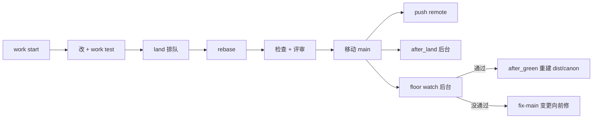

# 架构总览

只写现在的样子，只画两层：上下文（谁在用、依赖什么外部系统）和容器（运行时有哪些部件、数据存在哪、主要流程怎么走）。每一节末尾的编号指向为什么这么做的决策；部件内部怎么分、每个行为怎么要求，看领域 README 和规则（`canon context <路径或领域>`）。改了部件或主要流程的变更同一次合入里更新这里（D-65）。

## 上下文

- **使用者**：在项目里干活的 AI 会话（Claude Code），常常几个同时在跑；负责方向的人，只回答 `canon human` 里的问题。
- **git**：一切的底座。main 是一个分支，每个变更一个 worktree 和分支；canon 的协调数据放在 git 公共目录里。
- **Claude Code**：会话在它里面运行。canon 把 hook 和 skill 装进项目的 `.claude/`；读它的提问记录来佐证转述的回答；`canon usage` 只读它的会话记录。
- **`claude -p`**：非交互的 Claude，用于合入时的规则评审和合入后的代码评审，命令由 `canon/config.yaml` 配置。
- **GitHub**：代码评审发现的问题提成 issue（`gh`），`canon issues` 读取；决策里引用的网址在合入时被抓取核对。
- **项目自己的命令**：floor、类型检查、测试、`setup`、生命周期 hook，由 `canon/config.yaml` 配置，canon 只运行它们、看退出码。

决策：D-1、D-2、D-9、D-45、D-51。

## 容器

**CLI 二进制 `canon`**
- 职责：全部命令。每次运行读当前 checkout 里的 `canon/config.yaml`，读写协调数据库和 git；没有常驻进程（后台部件见下）。
- 数据：无；`dist/canon` 只在主 checkout 里，由 `after_green` 从测过的提交构建，PATH 上的 canon 指向它。
- 领域和代码：命令声明与退出码、配置读取在 `invocation`（`src/invocation`，`tree.ts` 按领域汇总各自的 `commands.ts`）；共享的 git、进程、结果类型在 `src/kernel`，不属于任何领域。
- 决策：D-2、D-3、D-4、D-15、D-63。

**协调数据库 `state.db`**
- 职责：多个会话同时工作时的共享状态：认领、合入队列、交接记录、留给人的问题、编号、端口、事件表（每次写入和拒绝，`canon stats` 从它算）、后台部件的登记（floor watch、代码评审、main 没通过的记录）。
- 数据：`<git 公共目录>/canon/state.db`（SQLite），本机所有 worktree 共用，不提交、不跨机器。知识（规则、决策）不放这里。
- 领域和代码：`work`（`src/work/db.ts`、`src/work/workspace.ts`），各子领域读写自己的表。
- 决策：D-11、D-18、D-33、D-41。

**主 checkout 与变更 worktree**
- 职责：主 checkout 签出 main，main 只通过 `canon work land` 前移；每个变更一个 worktree `<仓库名>.worktrees/C-n`、一个分支 `change/C-n`、一个认领（租约加进程探测）。快照和归档是 git ref：`refs/canon/snapshots/*`、`refs/canon/archive/*`。
- 数据：worktree 里的代码和 `canon/changes/C-n.md`；每个 worktree 的 `.canon/`（生成的 schema，被 git 忽略）。
- 领域和代码：`work/session`（`src/work/session`，开始、停下、交接、`canon brief`）、`work/claims`（`src/work/claims`）、`work/drop`（`src/work/drop`）、`work/snapshots`（`src/work/snapshots`）。
- 决策：D-11、D-13、D-18、D-30、D-62。

**`canon/` 文档树**
- 职责：项目的共享记忆，进版本库：`canon/product.md`、`canon/architecture.md`、`canon/config.yaml`、`canon/backlog.md`、`canon/rules/<领域>/`（规则和领域 README）、`canon/decisions/`、`canon/changes/`、`canon/notes/`，需要时有 `canon/releases/`。一个文档一个文件，只在合入时改。
- 数据：Markdown 加 front matter。`canon check` 查格式、引用、路径、规则有没有测试点名；`canon search`、`canon context` 读它。
- 领域和代码：`knowledge/documents`（`src/knowledge/documents`）、`knowledge/check`（`src/knowledge/check`）、`knowledge/query`（`src/knowledge/query`）、`knowledge/releases`（`src/knowledge/releases`）、`work/execution`（`src/work/execution`，规则的执行状态由变更里的通过记录算出）。
- 决策：D-1、D-12、D-14、D-15、D-32、D-61。

**装进项目的 hook、skill 和 git 守卫**
- 职责：Claude Code hook（会话开始跑 `canon brief`；每次 Bash 前快照；提问工具之后 `canon human record`）、`.claude/skills/canon-*`、git 的 `reference-transaction` hook（main 只能由 `canon work land` 移动）。
- 数据：项目的 `.claude/settings.json`、`.claude/skills/`、git hook 目录里的守卫文件；skill 的来源是 canon 自己仓库的 `.claude/skills`。
- 领域和代码：`install`（`src/install`：`init`、`install`、`update`、`uninstall`、`githook.ts`）。
- 决策：D-9、D-10、D-16、D-36、D-46、D-53。

**后台 floor watch（`floor_timing: after` 时）**
- 职责：合入后在 git 公共目录下的临时 worktree 里，对 main 的最新提交按批跑 floor；通过就移动 `refs/canon/green` 并运行 `after_green`（本仓库用它重建 `dist/canon`）；没通过就记下，由下一个会话 `canon work start --fix-main` 向前修。
- 数据：`refs/canon/green`，state.db 里的 watcher 和 red_main 表，日志在 git 公共目录下。
- 领域和代码：`work/watch`（`src/work/watch`）。
- 决策：D-31、D-55、D-59。

**after_land 命令和评审脚本**
- 职责：合入后在主 checkout 里后台运行配置的 `after_land` 命令；本仓库配的是 `scripts/code-review.ts`：攒批后让 `claude -p` 评审合入的代码，只找安全和并发问题，发现的提成 GitHub issue。合入时的规则评审走另一条路：`canon work land` 调配置的 `review` 命令（本仓库是 `scripts/review-claude.sh`），评审规则、决策、常驻说明的改动。
- 数据：`refs/canon/code-reviewed`，后台命令的日志和退出码（事件表）。
- 领域和代码：`work/hooks`（`src/work/hooks`，运行和记录 hook）、`knowledge/review`（`src/knowledge/review`，两种评审的提示词和结果）。
- 决策：D-2、D-19、D-21、D-51、D-59。

## 主要流程

**一个变更：从开始到合入**
1. `canon work start`：新建 worktree、分支、变更文件和认领，分端口，运行 `setup`（`work/session`、`work/claims`、`work/hooks`）。
2. 在 worktree 里改代码和文档；每次 Bash 前的 hook 存快照（`work/snapshots`）。
3. `canon work test`：类型检查，挑出相关测试逐个运行，最后 `canon check`（`work/verify`）。
4. `canon work land --finish`：先写关闭提交，进合入队列，一次只有一个合入者（`work/land/queue`）。
5. 轮到后 rebase 到 main；跑 floor（`floor_timing: after` 时推迟；只改 `floor_skip_paths` 下的文件时跳过）。
6. 在 rebase 后的树上依次：配置键检查、`canon check`、执行证据、版本检查、决策来源抓取、规则评审、常驻说明评审、`before_land`；任何一步被拒就整个合入被拒，main 不动（`work/land/checks`、`knowledge/review`）。
7. 确认 worktree 没变、轮次还在，再用比较并交换移动 main，git 守卫只放行这一条（`work/land/finish`、`install`）。
8. 把 main 推到 `remote`（失败不改变结果，`work/remote`）；确保 floor watch 在跑；后台运行 `after_land`。
9. 释放认领；`canon work after-land <C-n> --wait` 等后台命令和代码评审结果；`canon work clean <C-n>` 删 worktree。

决策：D-5、D-16、D-22、D-26、D-29、D-31、D-32、D-34、D-38、D-42、D-58。

**后台：floor watch**
1. 合入移动 main 后，如果 main 上的配置是 `floor_timing: after` 且没有 watcher 在跑，启动它；它在自己的进程组里，不受启动者被终止的影响。
2. main 安静够久、没测过的合入够多或最老的够久，才测最新提交；`canon floor watch --now` 立即测。
3. 通过：移动 `refs/canon/green`，运行 `after_green`；`after_green` 重建了 PATH 上的 canon 后，watcher 把后面的测试交给新的 canon 并结束。没通过：记进 red_main，`canon brief` 提示，修复变更排在队列最前。

决策：D-31、D-34、D-55、D-59。

**问人**
1. 会话 `canon human ask` 记下问题，不依赖答案的工作继续做；`canon human pending` 和 `canon brief` 让所有会话看到。
2. 人在对话里回答（Claude Code 的提问工具）；PostToolUse hook 把提问和回答记进 state.db 的事件表。
3. 会话 `canon human answer <n> --relayed "<原话>"`，canon 对照提问工具的记录，对不上只标记，不拦截。

决策：D-6、D-45、D-47。

**发版**
1. 规则带 `release: R-n` 标签；`canon release status` 按执行状态汇总。
2. `canon release ship R-n`：版本里每条规则都已通过、`canon human` 里有负责人对 `ship R-n` 的肯定回答，才开一个自己的变更，把版本设为 shipped 并合入，再打标签 `release/R-n`（`knowledge/releases`）。

决策：D-61。
